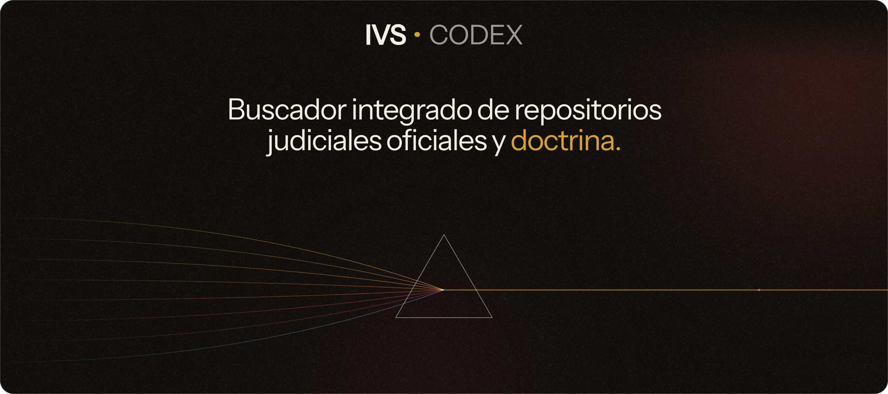
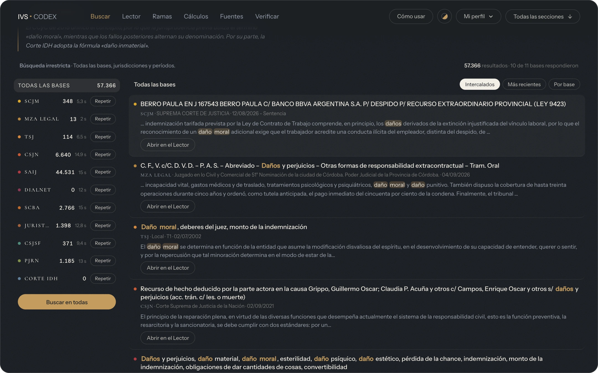
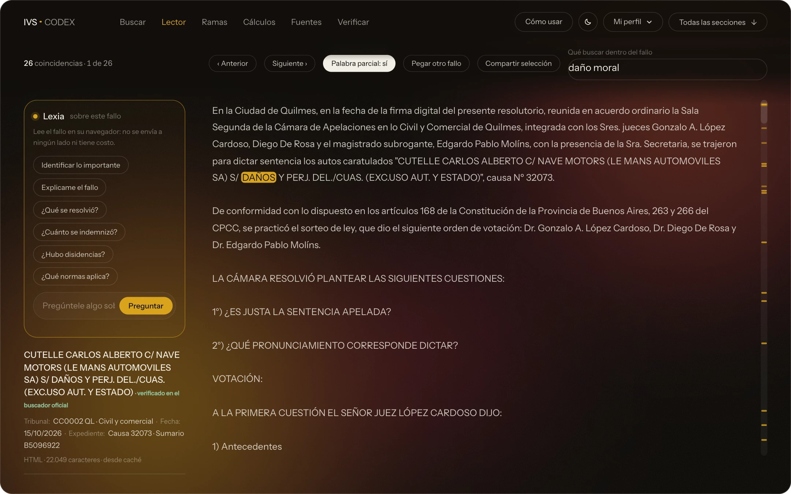
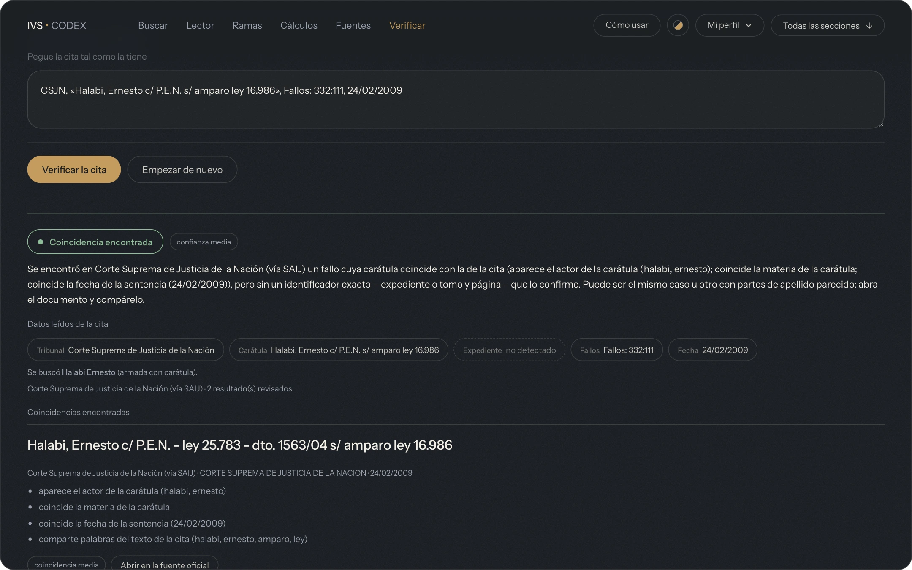
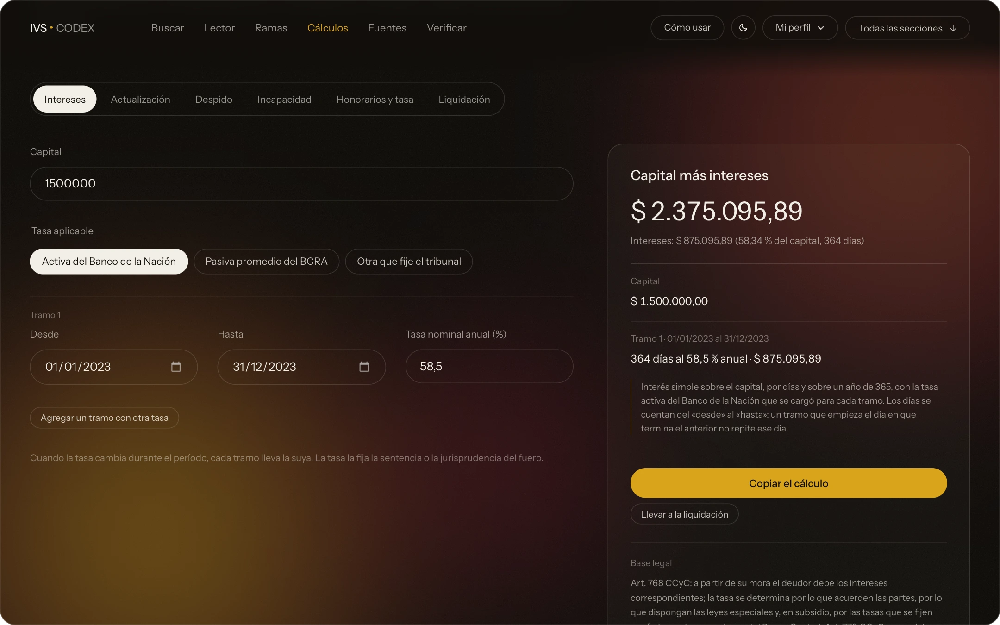
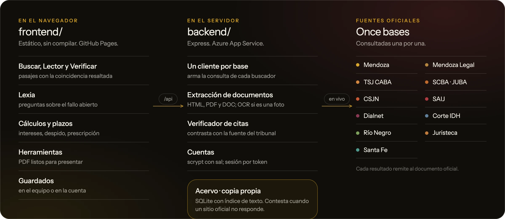

<div align="center">

<a href="https://luciazgagliardi.github.io/IVSCODEX/"></a>

<br>

**Buscador integrado de repositorios judiciales oficiales y doctrina.**<br>
Una consulta en once bases; cada resultado muestra el pasaje que coincide y remite al documento oficial.

<sub>**11** bases oficiales &nbsp;·&nbsp; **15** secciones &nbsp;·&nbsp; **106** fuentes en el catálogo &nbsp;·&nbsp; **97** pruebas automáticas</sub>

<br>

[Qué es](#qué-es) · [Capturas](#capturas) · [Secciones](#las-quince-secciones) · [Bases](#las-once-bases) · [Cómo funciona](#cómo-funciona) · [Puesta en marcha](#puesta-en-marcha) · [Despliegue](#despliegue) · [Referencia](#referencia-técnica) · [Seguridad](#seguridad) · [Licencia](#licencia)

</div>

<br>

## Qué es

IVS · CODEX reúne en una sola pantalla la jurisprudencia y la doctrina de once bases oficiales. La consulta se escribe una vez; la plataforma la adapta al lenguaje de cada buscador, junta las respuestas y muestra, en cada resultado, el pasaje donde aparece lo buscado. Desde ahí se abre el fallo completo en un lector que deja la búsqueda resaltada, se arma la cita y se la contrasta con la fuente oficial antes de usarla.

> [!IMPORTANT]
> **No genera ni resume jurisprudencia.** El texto que se muestra es el del documento oficial: la plataforma lo encuentra, lo recorta y lo señala, y cada resultado remite a su fuente. Lexia, el asistente del Lector, tampoco usa un modelo de lenguaje: aplica reglas sobre el texto del fallo abierto, dentro del navegador, y cada respuesta conserva el fragmento que la justifica.

El proyecto se llamó antes *Juris et de jure*, y el repositorio, `IURIS`. Algunos nombres internos conservan ese origen: el paquete `juris-et-de-jure-backend` y la aplicación «IURIS» de Azure App Service.

<br>

## Capturas

<div align="center">



<sub><b>QVAESTIO · Buscar.</b> Una consulta enviada a las once bases a la vez: la cantidad que devolvió cada una, los resultados intercalados y el pasaje con lo buscado resaltado.</sub>

<br><br>



<sub><b>LECTIO · Lector.</b> El fallo completo con las coincidencias señaladas en el texto y en el margen, los datos del documento y Lexia, que responde sobre el texto abierto sin enviarlo a ningún lado.</sub>

<br><br>



<sub><b>PROBATIO · Verificar.</b> Una cita pegada tal como se la tiene: se lee, se busca en la fuente que corresponde al tribunal y el veredicto lista los candidatos con el enlace al documento oficial.</sub>

<br><br>



<sub><b>CALCVLVS · Cálculos.</b> El resultado con su desglose por tramo y la norma que lo sostiene a la vista.</sub>

</div>

<br>

## Las quince secciones

Seis están siempre en la barra —Buscar, Lector, Ramas, Cálculos, Fuentes y Verificar—; el resto se abre desde «Todas las secciones». Cada una lleva su nombre latino. Además hay un recorrido guiado («Cómo usar») y seis paletas de color: Noche, Día, Descanso, Azul, Verde y Bordeaux.

| Grupo | Latín | Sección | Qué hace |
|---|---|---|---|
| **Investigar** | `QVAESTIO` | Buscar | Las once bases a la vez, con voces sugeridas por rama. |
| | `COLLATIO` | Comparar | Contrasta criterios de resolución por jurisdicción. |
| | `MATERIAE` | Ramas | Las 28 ramas del derecho y las voces con que indexan los buscadores. |
| | `REQVISITA` | Requisitos | Lo que exige cada trámite. |
| | `LEX` | Norma | Los artículos de las normas, desde InfoLeg. |
| **Leer y citar** | `LECTIO` | Lector | El fallo con su búsqueda destacada, por enlace, archivo o texto pegado. |
| | `CITATIO` | Citar | Formateador de citas. |
| | `PROBATIO` | Verificar | Contrasta una cita con las bases oficiales antes de presentarla. |
| | `VERBA` | Glosario | Latín jurídico. |
| **Calcular** | `CALCVLVS` | Cálculos | Intereses, actualización, despido, incapacidad, honorarios y tasa, liquidación. |
| | `TEMPVS` | Plazos | Plazos, prescripción y calendario. |
| **Preparar** | `INSTRVMENTA` | Herramientas | PDF listos para presentar: unir, dividir, foliar, reducir. Todo en el navegador. |
| **Fuentes** | `FONTES` | Fuentes | Catálogo de 106 bases y buscadores públicos, para abrir a mano. |
| **Archivo personal** | `THESAVRVS` | Guardados | Pasajes, fuentes y búsquedas guardadas. |
| | `RATIO` | Cuenta | Sincronización entre dispositivos. |

<br>

## Las once bases

Cada una tiene su propio cliente en [`backend/lib/`](backend/lib) (`indice<Base>.js`) y se registra en [`backend/lib/fuentes.js`](backend/lib/fuentes.js).

| Base | Identificador | Qué reúne |
|---|---|---|
| Poder Judicial de Mendoza | `mendoza` | Suprema Corte (por defecto), Cámaras Civiles y Cámaras del Trabajo. |
| Mendoza Legal | `mendozalegal` | Fallos elegidos por la revista del Colegio de Abogados de Mendoza, con resumen escrito por una persona y enlace al texto completo. Es una selección pequeña (unos 150 artículos). |
| TSJ de la Ciudad de Buenos Aires | `caba` | Sentencias del Tribunal Superior de Justicia. |
| SAIJ | `saij` | Sistema Argentino de Información Jurídica, del Ministerio de Justicia de la Nación: sumarios y fallos de todo el país. |
| Corte Suprema de Justicia de la Nación | `csjn` | Se consulta a través de la faceta correspondiente de SAIJ, porque el sitio de la Corte exige reCAPTCHA. |
| Suprema Corte de la Provincia de Buenos Aires | `scba` | JUBA: sumarios con su texto y el enlace al fallo completo. |
| Cámaras de la Ciudad de Buenos Aires | `juristeca` | Juristeca, del Consejo de la Magistratura de la Ciudad: fallos de las cámaras con su PDF. |
| Corte Suprema de Santa Fe | `santafe` | Sumarios con su texto y la sentencia completa en HTML. |
| Poder Judicial de Río Negro | `rionegro` | Superior Tribunal, cámaras y juzgados; cada fallo en PDF con texto. |
| Corte Interamericana de Derechos Humanos | `corteidh` | Sentencias, opiniones consultivas y resoluciones. |
| Dialnet | `dialnet` | Doctrina en español: artículos, libros y tesis. |

> [!NOTE]
> Dialnet y Mendoza Legal no son tribunales: una es doctrina y la otra, una selección. Por eso no sirven para confirmar que un expediente existe, y el verificador de citas nunca las consulta.

<br>

## Cómo funciona

<div align="center">



</div>

- **Frontend sin compilar.** [`frontend/`](frontend) es HTML, CSS y JavaScript puro. Los cálculos, los plazos, el glosario, el catálogo y las herramientas de PDF funcionan sin servidor; el servidor se necesita para buscar, traer un fallo por enlace, verificar citas y tener cuenta.
- **Pasajes con contexto.** Un mismo módulo ([`frontend/pasajes.js`](frontend/pasajes.js)) decide dónde coincide lo buscado, sin distinguir acentos ni mayúsculas y por la raíz de cada palabra; lo usan la lista de resultados, el Lector y el servidor.
- **Acervo propio.** El servidor guarda una copia en SQLite, con índice de texto completo, de casi todo SAIJ y de las demás bases ([`backend/lib/acervo.js`](backend/lib/acervo.js)). Las tandas de datos viajan en la rama `acervo` y se importan al arrancar. Cuando un sitio oficial no responde, Buscar contesta con esa copia en lugar de quedarse sin resultados. Requiere Node 22.5 o superior (`node:sqlite`); sin él, el acervo queda apagado y todo lo demás sigue igual.
- **Extracción de documentos.** El servidor descarga el enlace con las protecciones descritas en [Seguridad](#seguridad) y extrae el texto: HTML con Readability, PDF con pdf.js, DOC con word-extractor. Si el PDF es una imagen, ofrece reconocimiento óptico de caracteres (OCR).
- **TSJ de CABA.** Su sitio responde con un desafío de Cloudflare a los servidores; [`backend/lib/navegadorCf.js`](backend/lib/navegadorCf.js) abre un Chrome sin interfaz para resolverlo y pedir los PDF.
- **Cuentas.** La contraseña se guarda con scrypt y una sal por usuario; la sesión viaja como `Authorization: Bearer <token>`, no como cookie.

<br>

## Puesta en marcha

Requisitos: **Node 18.17 o superior** para el servidor (22.5 o superior si se quiere el acervo; el servidor publicado usa Node 24). El frontend no necesita nada instalado.

### Solo el frontend

Abrir [`frontend/index.html`](frontend/index.html) en el navegador, o servir la carpeta con cualquier servidor estático. Sin servidor propio, la página prueba la misma dirección, `http://localhost:3000` y, por último, el servidor publicado.

### Frontend y servidor

```bash
git clone https://github.com/luciazgagliardi/IVSCODEX.git
cd IVSCODEX/backend
npm install
npm start
```

El servidor queda en `http://localhost:3000` y, en desarrollo, también sirve `frontend/` en la raíz: es la forma más simple de probar todo junto. Toda la configuración es opcional; para ajustarla se copia la plantilla (`cp .env.example .env`, o `copy` en Windows).

| Comando (desde `backend/`) | Qué hace |
|---|---|
| `npm start` | Inicia el servidor. |
| `npm run dev` | Lo reinicia solo al guardar cambios. |
| `npm test` | Corre las 97 pruebas automáticas (unos 7 segundos). |
| `npm run limpiar-cache` | Vacía `backend/cache`. |

<br>

## Despliegue

Las dos mitades se publican por separado, cada una con su flujo de GitHub Actions en [`.github/workflows/`](.github/workflows).

| Parte | Destino | Flujo | Se dispara con cambios en |
|---|---|---|---|
| Frontend | [GitHub Pages](https://luciazgagliardi.github.io/IVSCODEX/) | `pages.yml` | `frontend/**` |
| Servidor | Azure App Service | `azure-backend.yml` | `backend/**` y `frontend/pasajes.js` |

- **Pages.** Se activa una sola vez, en *Settings → Pages → Build and deployment → Source: GitHub Actions*. El flujo publica únicamente el contenido de `frontend/`.
- **Azure.** El flujo trae las tandas del acervo desde la rama `acervo`, copia `frontend/pasajes.js` a `backend/lib/pasajes.cjs` (el servidor usa el mismo módulo que la página), instala con `npm ci` en Node 24 y despliega con el secreto `AZURE_WEBAPP_PUBLISH_PROFILE`. En App Service los datos que deben sobrevivir a un despliegue —cuentas, índices, acervo— se guardan en `/home/datos`.
- **Conexión.** La página elige el servidor al abrirse: la misma dirección (`/api`), después `http://localhost:3000/api` y, por último, la dirección publicada que figura en la función `detectarServidor()` de [`frontend/index.html`](frontend/index.html). Si el servidor vive en otro dominio, ese origen se agrega a `CORS_ORIGENES`; sin ello el navegador bloquea las respuestas.
- **Acervo.** [`backend/scripts/actualizarAcervo.mjs`](backend/scripts/actualizarAcervo.mjs) vuelve a bajar de SAIJ los últimos tres meses, rearma las tandas y las publica; está pensado para correr una vez por mes.

<br>

## Referencia técnica

<details>
<summary><b>API</b></summary>

<br>

Todas las rutas cuelgan de `/api`. Ante un error siempre llega JSON con `codigo` (estable, para el frontend) y `mensaje` (en castellano), por ejemplo `DOMINIO_NO_PERMITIDO`, `PDF_ESCANEADO`, `HTML_SIN_TEXTO`, `TIEMPO_AGOTADO` o `RED_PRIVADA`.

| Método | Ruta | Qué hace |
|---|---|---|
| `POST` | `/extraer` | Cuerpo `{ "url", "refrescar" }`. Descarga el documento y devuelve su texto. |
| `POST` | `/extraer-archivo` | Lo mismo para un archivo subido (bytes en el cuerpo, nombre en `X-Nombre-Archivo`). |
| `POST` | `/ocr`, `/ocr-archivo` | Reconocimiento de texto para PDF escaneados, por enlace o por archivo. |
| `POST` | `/indice/<base>/buscar` | Busca en vivo en una base. Cuerpo: `q` y, opcionalmente, `modo`, `pagina`, `desde`, `tribunal`, `excluir`, `anioDesde`, `anioHasta`, `articulo`, `norma`, `provincia`. |
| `POST` | `/indice/<base>/local` | La misma búsqueda sobre la copia local, sin consultar al sitio oficial. |
| `POST` | `/indice/<base>/fragmentos` | Pasajes de una lista de enlaces para una consulta. |
| `GET` | `/indice/<base>/estado` | Estado del índice de esa base. |
| `POST` | `/verificar-cita` | Cuerpo `{ "texto" }`. Busca la cita en las fuentes y devuelve un veredicto. |
| `POST` | `/leer-cita` | Solo interpreta la cita, sin consultar la red. |
| `GET` | `/legislacion/normas`, `/legislacion/:norma/:articulo` | Normas y artículos. |
| `GET` | `/series/:clave` | Serie oficial que el navegador no puede leer directamente (hoy, RIPTE). |
| `GET` | `/tesauro/estado` · `POST /tesauro/proponer` | Tesauro de sinónimos; la propuesta de anillos nuevos requiere `ANTHROPIC_API_KEY`. |
| `GET` | `/acervo/estado`, `/fuentes/estado` | Estado del acervo y de cada fuente. |
| `POST` | `/auth/registro`, `/auth/login`, `/auth/logout` | Cuentas. |
| `GET` · `PUT` | `/auth/yo`, `/auth/perfil`, `/mis-datos` · `POST /mis-datos/fusionar` | Perfil y datos personales; requieren sesión. |
| `GET` | `/salud`, `/dominios`, `/verificar?url=` | Estado del servidor (el detalle solo para administración), lista blanca vigente y si un enlace es procesable. |
| `DELETE` | `/cache` | Vacía la caché; exige `X-Admin-Token`. |

`<base>` es uno de los identificadores de [Las once bases](#las-once-bases). Una prueba rápida desde la terminal:

```bash
curl -X POST http://localhost:3000/api/indice/saij/buscar \
  -H "Content-Type: application/json" \
  -d '{"q":"daño moral"}'
```

La respuesta de `/extraer` incluye, entre otros campos, `tipo` (el formato del documento), `titulo`, `texto`, `caracteres`, `palabras`, `metodo`, `desdeCache` y `ms`.

</details>

<details>
<summary><b>Configuración</b></summary>

<br>

Todo se ajusta con variables de entorno, normalmente en `backend/.env` (plantilla: [`backend/.env.example`](backend/.env.example)). Los valores de la tabla son los predeterminados de [`backend/config.js`](backend/config.js).

| Variable | Valor predeterminado | Para qué sirve |
|---|---|---|
| `PORT` | `3000` | Puerto del servidor. |
| `CORS_ORIGENES` | `localhost` y `127.0.0.1`, puertos 3000 y 5500 | Orígenes desde los que se puede llamar a la API. |
| `TIMEOUT_MS` | `25000` | Espera máxima al sitio de origen. |
| `MAX_BYTES` | `26214400` (25 MB) | Tamaño máximo de descarga. |
| `MAX_REDIRECCIONES` | `5` | Redirecciones que se siguen, una por una. |
| `CACHE_HORAS` | `24` | Duración de la caché (`0` la desactiva). |
| `ESPERA_POR_HOST_MS` | `1500` | Pausa mínima entre dos pedidos al mismo sitio. |
| `USER_AGENT` | `JurisEtDeJure/1.0 (…)` | Identificación ante los organismos; conviene poner un contacto real. |
| `LIMITE_PETICIONES` · `LIMITE_VENTANA_MS` | `120` · `300000` | Límite general de pedidos por ventana (5 minutos). |
| `LIMITE_CITAS` · `LIMITE_CITAS_VENTANA_MS` | `30` · `900000` | Verificaciones de cita por ventana (15 minutos). |
| `OCR_HABILITADO` | `true` | `false` apaga el OCR sin tocar código. |
| `OCR_MAX_PAGINAS` · `OCR_TIMEOUT_MS` | `6` · `180000` | Páginas y tiempo máximos por pedido de OCR. |
| `PERMITIR_CUALQUIER_DOMINIO` | `false` | `true` acepta cualquier dominio público, no solo la lista blanca. |
| `PERMITIR_RED_PRIVADA` | `false` | Solo para las pruebas automáticas; nunca en un servidor real. |
| `ADMIN_TOKEN` | vacío | Clave para `DELETE /api/cache` y el detalle de `/api/salud` (cabecera `X-Admin-Token`). |
| `ANTHROPIC_API_KEY` | vacío | Opcional: habilita proponer anillos nuevos del tesauro. Solo del lado del servidor. |
| `SCRAPER_API_KEY` | vacío | Clave del proxy que usa el buscador del TSJ de CABA. |
| `DIR_DATOS` | junto al código; `/home/datos` en App Service | Dónde viven cuentas, índices, caché y acervo. |
| `DIR_CACHE`, `DIR_INDICE`, `DIR_OCR_CACHE`, `DIR_USUARIOS`, `DIR_ACERVO`, `DIR_ACERVO_DATOS` | subcarpetas de `DIR_DATOS` | Cada carpeta por separado, si hace falta moverla. |
| `CHROME_PATH` | detección automática | Chrome local para el TSJ de CABA en una máquina propia. |
| `ACERVO_COPIA_LOCAL`, `CORPUS_CORTEIDH`, `COSECHA_CABA` | activos en el servidor publicado | `1` o `0` para forzar la lectura desde la copia local, el índice de texto de la Corte IDH y la cosecha lenta del TSJ de CABA. |
| `RELE_URL` · `RELE_CLAVE` | vacío | Relevo opcional de Cloudflare Workers (ver [`backend/relay/LEEME.md`](backend/relay/LEEME.md)); se probó y no resolvió el caso del TSJ, y queda como respaldo. |

**Agregar una fuente a la lista blanca:** se suma el dominio a `DOMINIOS_PERMITIDOS` en `backend/config.js` y se reinicia. Acepta subdominios: con `csjn.gov.ar` queda habilitado también `sjconsulta.csjn.gov.ar`.

</details>

<details>
<summary><b>Estructura del repositorio</b></summary>

<br>

```text
IVSCODEX/
├── README.md
├── docs/                         Imágenes del README y el script que las regenera
│   ├── img/                      Cabecera, capturas y diagrama
│   ├── arquitectura.html         Fuente del diagrama
│   └── capturar.mjs              Vuelve a sacar las imágenes (ver «Imágenes del README»)
├── .github/workflows/            pages.yml · azure-backend.yml
│
├── frontend/                     Estático, sin compilar: lo que se publica en GitHub Pages
│   ├── index.html                La aplicación (buscador, lector, cálculos, etc.)
│   ├── portada/                  La portada, que se muestra en un marco dentro de index.html
│   ├── pasajes.js                Recorte de pasajes; el servidor usa el mismo módulo
│   ├── analisis-fallo.js         Lexia: reglas sobre el texto del fallo abierto
│   ├── lexia-picante.js          Lo que Lexia contesta a insultos, piropos y provocaciones
│   ├── nombre-fallo.js           Buscar un fallo por su carátula
│   ├── calculos.js               Núcleo de las calculadoras, sin pantalla
│   ├── herramientas.js           Herramientas para preparar PDF
│   ├── catalogo.html             Catálogo de fuentes independiente
│   ├── clasico.html · script.js · styles.css   Primera versión, de formulario simple
│   ├── datos/                    Tesauro de sinónimos y citas de fallos
│   ├── vendor/                   pdf.js y pdf-lib
│   └── opciones/ · portadas/ · rumbos/ …       Maquetas y exploraciones de diseño
│
└── backend/                      Express: se despliega aparte de frontend/
    ├── index.js · config.js      Arranque, seguridad, límites y configuración
    ├── routes/                   extraer · indice · citas · auth
    ├── lib/                      Descarga, extracción, un cliente por base, acervo, verificador, OCR, cuentas
    ├── scripts/                  Cosecha y armado del acervo
    ├── respaldo/                 Copia de respaldo de cada base
    ├── relay/                    Relevo opcional de Cloudflare Workers
    └── test/                     Pruebas automáticas (97) y fallos de muestra
```

</details>

<details>
<summary><b>Imágenes del README</b></summary>

<br>

La cabecera y las capturas salen de la aplicación real, con esquinas redondeadas y fondo transparente para que se vean bien en el tema claro y en el oscuro de GitHub. Cuando el diseño cambie, se regeneran con un solo comando, desde la raíz del repositorio y con el servidor en marcha:

```bash
node docs/capturar.mjs
```

Hace falta Chrome (`CHROME_PATH` si no está en la ruta de macOS) y conexión a internet: la búsqueda y la verificación consultan las bases oficiales de verdad. Con `API_REMOTA=https://…/api` las consultas las contesta el servidor publicado, que tiene el acervo completo; con `CONSULTA=…` se cambia la búsqueda de ejemplo. Se puede pedir una sola imagen por nombre (`cabecera`, `buscar`, `lector`, `verificar`, `calculos`, `arquitectura`).

</details>

<br>

## Seguridad

Un servidor que descarga «cualquier enlace que le manden» es vulnerable a **SSRF**: alguien le pasa `http://169.254.169.254/` (la dirección de metadatos de AWS, Azure y Google Cloud) y el propio servidor le entrega las credenciales, o le pasa una dirección de la red interna y se la mapea. Por eso, **antes de cada salto de red**, el descargador ([`backend/lib/descargador.js`](backend/lib/descargador.js)):

1. exige `http` o `https`; no acepta `file:`, `ftp:` ni `gopher:`;
2. exige que el dominio esté en la lista blanca (`GET /api/dominios`);
3. resuelve el DNS y rechaza la dirección si es interna;
4. sigue las redirecciones **a mano**, repitiendo los tres controles en cada salto: un dominio público puede redirigir a `127.0.0.1`, y dejar que `fetch` lo haga solo es el descuido más común.

Hay una prueba automática que verifica precisamente ese cuarto punto. Además:

- **Cabeceras de seguridad.** `helmet` con política de contenido (CSP) cerrada, HSTS, `nosniff` y política de referencia; la página no puede incrustarse en otro sitio.
- **Límites por tipo de pedido.** Un límite general (120 por cada 5 minutos) y otros más estrictos para inicio de sesión (12 cada 15 minutos), OCR (6), archivos subidos (20) y verificación de citas (30). Este último protege a los sitios oficiales más que al servidor: cada verificación dispara búsquedas reales contra ellos.
- **Cuentas.** Contraseñas con scrypt y sal; el inicio de sesión tarda lo mismo si el correo existe o no, para que no se puedan enumerar cuentas midiendo tiempos.
- **Rutas de administración.** `DELETE /api/cache` y el detalle de `/api/salud` exigen `X-Admin-Token`; sin esa clave configurada, solo responden desde la propia máquina y fuera de producción.
- **Datos personales.** La carpeta de cuentas no entra al repositorio (`.gitignore`) y las respuestas que llevan tokens no se guardan en caché.

**Buen trato con los servidores oficiales.** Esto no es un extractor masivo: baja el documento que se pidió. Aun así conserva una pausa entre pedidos al mismo sitio (`ESPERA_POR_HOST_MS`), una caché de 24 horas y un `User-Agent` identificable; conviene reemplazar el contacto de `USER_AGENT` por uno propio. Los organismos pueden bloquear el acceso si se abusa, y están en su derecho: uso personal, volumen bajo y sin redistribuir bases enteras.

<br>

## Límites conocidos

<details>
<summary><b>Qué no va a funcionar, y qué hacer entonces</b></summary>

<br>

- **Buscadores que no exponen el fallo en una dirección fija.** Varios sistemas judiciales muestran los resultados por `POST` o dentro de una sesión. Si se pega la dirección del buscador, se extrae el formulario y no la sentencia. Conviene buscar el enlace del documento (suele estar en «ver fallo», «descargar PDF» o el ícono de impresión).
- **Páginas que se arman con JavaScript.** El servidor descarga el HTML pero no ejecuta scripts; si el fallo se carga después, llega vacío y aparece `HTML_SIN_TEXTO`. La única excepción es el TSJ de CABA, que se abre con Chrome.
- **Bases con CAPTCHA o desafío de bot.** El sitio propio de la Corte Suprema exige reCAPTCHA (se la consulta por SAIJ) y otros, como SciELO, se protegen con un desafío. No se integraron.
- **PDF escaneados.** No tienen capa de texto. El sistema lo detecta y responde `PDF_ESCANEADO`; el Lector ofrece entonces **«Aplicar OCR»**.
- **La colección *Fallos* por tomo y página.** Ninguna fuente integrada la expone como campo buscable (el buscador de la Corte, que sí la tiene, exige reCAPTCHA). Una cita `Fallos: 340:1084` puede confirmarse si el fallo aparece por su carátula, pero no buscarse por tomo y página.

En los dos primeros casos, el plan alternativo siempre funciona: abrir el enlace en el navegador, copiar el texto y pegarlo en el Lector, que no necesita servidor.

#### OCR

El OCR descarga el PDF, convierte cada página en imagen con [`@hyzyla/pdfium`](https://github.com/hyzyla/pdfium) (el motor de PDF de Chrome compilado a WebAssembly, sin dependencias nativas) y le aplica [Tesseract](https://github.com/naptha/tesseract.js) en español. Tarda varios segundos por página, por eso es un botón aparte y no algo automático; el resultado queda en la caché y solo se paga una vez por enlace.

El límite predeterminado es bajo a propósito: medido en el plan publicado de Azure, **6 páginas tardaron 170 segundos** (unos 28 por página), y a ese ritmo 20 páginas superarían los 230 segundos que App Service deja abierta una conexión inactiva. Con más CPU, o en una máquina propia, se puede subir `OCR_MAX_PAGINAS`.

Para un resultado de mejor calidad y sin tope de páginas, la herramienta libre es `ocrmypdf`:

```bash
brew install ocrmypdf                      # macOS
sudo apt install ocrmypdf tesseract-ocr-spa  # Ubuntu o Debian

ocrmypdf -l spa fallo.pdf fallo-con-texto.pdf
```

</details>

<br>

## Verificar antes de citar

La plataforma ahorra el copiar y pegar, no la verificación. Antes de que una cita entre en un escrito:

1. Confirmar que la carátula existe en la base oficial del tribunal que la dictó.
2. Cruzar tomo y página con la colección *Fallos*, o el número de expediente si es provincial.
3. Leer el considerando completo, no solo el pasaje resaltado.
4. Revisar quién votó y si hubo disidencia.
5. Controlar que el criterio siga vigente.
6. Guardar el PDF con la fecha de consulta.

Los datos que la interfaz detecta —carátula, tribunal, fecha, expediente— salen de patrones de texto, no de una base de datos: están para ahorrar tipeo y hay que confirmarlos.

<details>
<summary><b>El verificador de citas</b></summary>

<br>

El primer paso de esa lista está automatizado en la sección **Verificar**. Nació por el problema de las **citas alucinadas**: un modelo de lenguaje produce citas con la forma exacta de una verdadera —tribunal que existe, carátula creíble, tomo y página en el rango correcto— que no se distinguen leyéndolas. La única manera es ir a la fuente.

1. **Lee la cita** ([`backend/lib/citas.js`](backend/lib/citas.js)): tribunal, expediente, tomo y página de *Fallos*, carátula partida en actor, demandado y materia, fecha y palabras de búsqueda. Son expresiones regulares, no un analizador formal, porque una cita argentina no tiene un formato: tiene el de cada tribunal, el de cada revista y el que cada quien escribe de apuro. **Un campo que no se reconoce queda vacío**; nunca se completa con lo que «seguramente quiso decir».
2. **Elige a quién preguntar** ([`backend/lib/verificarCita.js`](backend/lib/verificarCita.js)): si reconoce el tribunal, consulta su buscador y ninguno más; si no, tira una red ancha pero corta —SAIJ y la Corte vía SAIJ—. Cada consulta es un pedido real al servidor de un organismo, por eso el alcance es acotado y la pantalla lo declara.
3. **Busca y puntúa.** El expediente exacto y el tomo y página exactos valen, cada uno, lo que todo lo demás junto, porque son identificadores: o coinciden o no. Los apellidos de las partes valen la mitad y no alcanzan por sí solos: hay apellidos repetidos hasta el hartazgo.
4. **Devuelve un veredicto**, con su confianza, la explicación y los candidatos con el enlace a la fuente oficial.

| Veredicto | Rótulo en pantalla | Qué significa |
|---|---|---|
| `verificada` | Coincidencia encontrada | Apareció un fallo que coincide por un identificador exacto o por la carátula entera. Aun así se pide abrir el documento: que el fallo exista no significa que diga lo que la cita le atribuye. |
| `no_encontrada` | No la encontramos | Se buscó y no apareció nada convincente. **Nunca dice que la cita sea falsa**: puede no estar indexada, estar cargada con otra carátula o no ser real, y las tres posibilidades siguen abiertas. |
| `no_verificable` | No se pudo verificar | No se pudo ni intentar: el texto no tiene forma de cita, el tribunal no lo cubre ninguna fuente integrada o los buscadores no respondieron. **Una fuente caída nunca se informa como «no encontrada»**. |

Límites que conviene tener presentes: no existe un índice de *Fallos* por tomo y página; el alcance es el de las fuentes que cubren el tribunal reconocido, no «toda la jurisprudencia argentina»; Mendoza obliga a elegir el tribunal antes de buscar; y se examina la primera página de resultados, de modo que una carátula escrita de otra forma puede quedar afuera. El límite `LIMITE_CITAS` protege a los sitios oficiales, no a este servidor.

Las pruebas ([`backend/test/citas.prueba.js`](backend/test/citas.prueba.js)) corren sin internet, con la búsqueda simulada. La más importante es la última: un veredicto negativo nunca usa la palabra «falsa».

</details>

<br>

## Licencia

MIT para el código. El contenido de los fallos pertenece a los organismos de origen y se rige por sus condiciones de uso.

<br>

<div align="center">
<sub>IVS · CODEX</sub>
</div>
